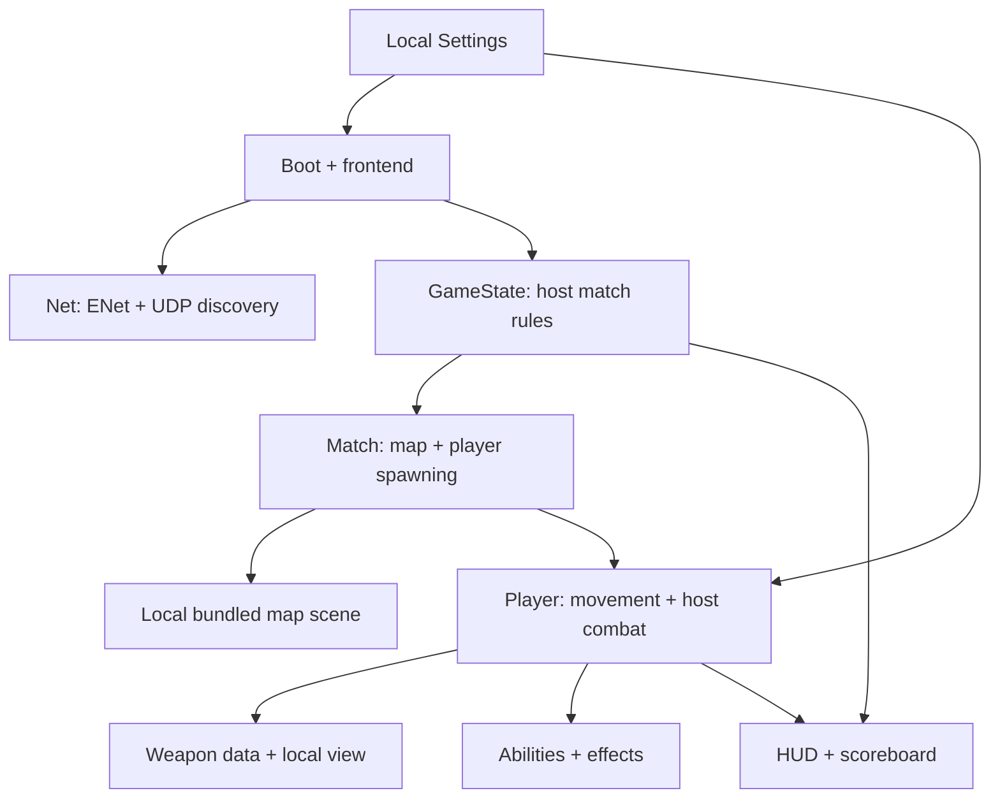

# RIFTOPS architecture audit

Audit date: 2026-11-16. Scope: the supplied Valu source tree, assets, scenes, resources, export configuration, tests and publishing metadata. This is a source audit with baseline validation recorded below; it is not certification of Android or LAN performance.

## Baseline and workspace integrity

- Project root: `D:/personal projects/RIFTOPS`; `project.godot` starts `scenes/boot.tscn`.
- Git metadata is in `valu/.git`, but its working files are in the parent directory. `git -C valu status` reports tracked files deleted. Do not reset, clean, or move files to repair this without first reconciling the checkout.
- Git HEAD: `c4d1024` (Release Valu 1.0.0 as open source), 707 tracked paths. Comparing those paths with the parent tree found one absent tracked file: `LICENSE`. After documenting the audit, the exact notice was restored from HEAD; original/restored Git blob hashes both equal `eee0a0abb53a8bc8a5f9ddb10464e9451947b564`.
- Inventory before audit output: 39 GDScript files, 8 scenes, 11 resource definitions, 85 glTF files, 66 binary buffers, 1 GLB, 4 fonts, 72 OGG and 13 WAV files. Imported-resource descriptors exist; an imported `.godot` cache did not.
- `project.godot` declares Godot 4.7 features and the Mobile renderer. README and conventions pin **4.7.1.stable.official.a13da4feb**. The downloaded official Windows editor reports that exact version. This is GDScript, not C#.
- The original source is preserved. Import/testing uses `builds/audit-baseline`, a separate copy. Baseline logs are under `builds/`.
- Read-only comparison with `git --git-dir=valu/.git --work-tree=. diff --stat HEAD` is empty after license restoration. This verifies the relocated tracked tree matches HEAD without moving Git metadata. Audit documents are new, untracked additions. `docs/BASELINE_SOURCE_HASHES.csv` records 57 gameplay/script/scene/resource SHA-256 hashes.

## Architecture and dependencies

| Layer | Actual paths | Responsibility and integration boundary |
|---|---|---|
| Bootstrap | `scenes/boot.tscn`, `scripts/ui/boot.gd`, `scripts/cli.gd` | Instantiates menu and lobby; connects host/join/leave signals; supports automated CLI sessions |
| Transport/session | `autoload/net.gd` | ENet lifecycle, registry, teams, loadouts, agents, UDP room discovery |
| Match state | `autoload/game_state.gd` | TDM and Spike, clocks, rounds, economy, kills, stats, start/end RPCs |
| Local preferences | `autoload/settings.gd` | `user://settings.cfg`, player name/loadout, sensitivity, ADS, touch mode, render scale |
| Match scene | `scenes/match.tscn`, `scripts/match.gd` | Loads selected map; server spawns players; ready barrier, respawning, buy barriers |
| Player/physics/combat | `scenes/player.tscn`, `scripts/player.gd`, `scripts/hitbox.gd` | CharacterBody3D movement, camera, server hit resolution, health, inventory authority, remote visuals |
| Weapons | `scripts/weapon_data.gd`, `scripts/weapon_db.gd`, `weapons/*.tres`, `scripts/weapon_manager.gd`, `scripts/weapon_view.gd` | Data-driven stats, local predicted presentation, requests to authoritative Player combat |
| Abilities | `agents/*.tres`, `scripts/agent_data.gd`, `scripts/agent_db.gd`, `scripts/ability_data.gd`, `scripts/ability_controller.gd` | Four agents, three abilities each, charge validation and cast requests |
| World effects | `scripts/effects_manager.gd`, `scripts/ability_projectile.gd`, `scripts/wall_segment.gd`, `scripts/spike_entity.gd` | Server effect lifecycle and client visual RPCs; plant/defuse entity |
| Presentation | `scripts/fx.gd`, `scripts/sfx.gd` | Transient visual/audio creation and cached/synthesized audio |
| Frontend | `scenes/ui/main_menu.tscn`, `scenes/ui/lobby.tscn`, corresponding `scripts/ui/*.gd` | Mostly programmatically constructed controls; host settings, player list, discovery, preferences |
| HUD | `scripts/ui/hud.gd`, `crosshair.gd`, `scoreboard.gd`, `buy_menu.gd`, `smoke_target_overlay.gd`, `touch_controls.gd`, `ui_util.gd` | Combat signals, modal input gating, team scoreboard, touch routing and layout helpers |
| Maps | `maps/graybox/graybox.tscn`, `maps/solstice/solstice.tscn` | Static geometry, world collision, team spawns, plant zones, lighting |
| Tools/testing | `tests/*.sh`, `scripts/test_hooks.gd`, `scripts/spike_test_hooks.gd`, `scripts/screenshot_probe.gd`, `maps/solstice/tools/*.gd`, `tools/make_icons.gd` | Headless multiplayer scenarios, map checks, screenshots, icon generation |
| Packaging | `export_presets.cfg`, `fastlane/`, `publishing/` | Android export and original Valu store/distribution metadata |

## Multiplayer authority: precise current model

1. `Net.host_game()` creates ENet on UDP 27015. Peer 1 is both host and playable participant. `join_game()` creates a client. No cloud service or gameplay HTTP dependency was found in `scripts/` or `autoload/`.
2. Host broadcasts JSON to UDP 27016 every second; listeners expire entries after 3.5 seconds. Protocol identifier is `valu`. Manual-IP fallback exists. Discovery can fail independently of ENet connectivity.
3. Client registers name/loadout/agent through `srv_register`; host validates resource IDs, assigns a team, and broadcasts `cl_players`. Team capacity is 1–5 per side; transport MAX_PLAYERS is 10. Discovery advertises the constant maximum rather than the selected team capacity.
4. Host calls `GameState.host_start_match`; authoritative `cl_start_match` distributes map, mode, seed and rule configuration before loading the match scene.
5. `MultiplayerSpawner` owns player creation at `Players/<peer-id>`. Client scene readiness is distinct from a lobby-ready button: `srv_client_ready`, `_ready_peers`, an eight-second fallback and per-peer visibility prevent early spawn replication.
6. Player root combat RPC authority stays with the server. **MoveSync authority belongs to the owning player**, replicating position/yaw/pitch/crouch at a configured 0.04-second interval (25 Hz). Remote instances lerp toward received position, snapping beyond four metres. There is no input-replay reconciliation or rewind lag compensation here.
7. `srv_fire` checks sender ownership. Host checks alive/match state, equip and reload timing, fire cadence and ammunition; computes spread, performs the physics raycast and applies distance/region damage. Health, death, respawn, hit-confirmation and kill-feed messages originate on the host.
8. This is **server-authoritative damage, not fully authoritative movement**. Host accepts client movement and aim-related spread flags; shot origin is only replaced when more than three metres from the inferred eye. No finite-vector guard was found. Improve separately with tests, not during visual changes.
9. TDM uses team kill totals, 600 seconds by default, target 40, and three-second respawns. Per-player K/D/A bookkeeping currently occurs after the TDM early return in `server_report_kill`, so it is effectively Spike-only.
10. Player departures remove registry entries and player nodes. Spike handles carrier loss and forfeits. The frontend handles host loss, but that controller is replaced when entering a match: in-match host-loss recovery needs explicit coverage and likely a persistent handler.

## Maps and the previously unseen-map question

Both maps are real files, not missing plans. `lobby.gd::_scan_maps` enumerates subdirectories, accepting `<name>/<name>.tscn` through `ResourceLoader.exists`. `_on_start` passes the selected path; `match.gd::_ready` loads it under MapRoot. Export includes all resources and excludes map **tools**, not the map scenes.

- **Graybox:** existing test arena, also the default in GameState and `boot.gd` CLI hosting. The two-instance and most Spike tests deliberately use it.
- **Solstice:** Mediterranean two-site arena with textured world solids, modular props, indoor/route geometry, HDR sky, sunlight, fog, five spawn markers per team, plant zones and buy barriers. `maps/solstice/tools/validate_map.gd` checks spawn orientation/separation, zones, collision and resource counts.
- Solstice has LightmapGI settings but no assigned baked light data. This is a lighting-quality gap, not evidence that the map is absent.
- Map scenes do not supply the gameplay camera; a spawned local player's camera supplies the view. Running a map scene alone is not equivalent to starting a match.
- Most likely explanations to investigate: CLI default Graybox; lobby's first discovered option without a deliberate Solstice selection; direct scene execution without a player camera; an older/different APK. Export discovery/import failures remain hypotheses until tested in an APK.
- **No exact cause is claimed for the user's previous build:** its APK, logs, version and selected map were not available. Reproduce with explicit `--host --map solstice`, then the exported map selector on both devices.

## Character, camera, weapon, physics and art findings

Player is a CharacterBody3D capsule with standing/crouch logic, jump and walk/run speeds. Head contains a 75-degree camera; near plane is 0.05. ADS interpolates FOV, while recoil affects camera and weapon presentation. World/player/hitbox/utility/trigger layers are named in `project.godot`; player collision uses world and player masks, while separate head/body/leg Areas resolve shots.

Quaternius characters are loaded from agent resource model paths, normalized and hidden locally. Remote animation switches Idle/Run; imported animation libraries contain more clips than are integrated. Third-person guns are attached at a fixed offset, not a complete hand-bone rig. First-person hands are not implemented. Reload is a viewmodel rotation tween; death uses a primitive capsule corpse. These are presentation systems to replace incrementally, not finished character animation.

Seven weapon definitions and actual glTF gun assets exist. `WeaponView` loads models and has primitive fallback geometry if loading fails. Recoil, sway, bob, ADS, muzzle flash, tracers, impacts, firing audio and hit markers are already implemented. Do not mistake fallback code for the only supplied weapon art. New rifle art should retain weapon IDs/stats and request interfaces until a deliberate protocol/content migration.

Effects create and free nodes/materials per event. There is no general pooling strategy. Solstice's large shadow distance and textures require device profiling. Mobile rendering, ETC2/ASTC import, MSAA, mobile shadow overrides and mobile 0.85 render scale are configured; none establishes measured Android FPS.

## Assets and license evidence

`docs/ASSETS.md` and `CREDITS.md` record Quaternius, ambientCG, Poly Haven, Kenney and other audio sources. Bundled notices exist for Quaternius character/prop packs, Kenney audio and Rajdhani OFL. Michel Baradari grunt recordings require CC BY 3.0 attribution. Existing documentation is provenance evidence, not a new independent legal verification of each source. Check sources and preserve notices before redistribution; do not relabel all assets MIT.

All 85 glTF JSON files parsed and their external buffer/image URIs resolved locally in the audit. Literal runtime resource-path checks found no missing runtime assets after excluding formatted paths, comments and icon-generator paths. Four export launcher icon PNG paths are absent from `assets/icons/`; the generator exists, but three adaptive SVG inputs are also absent, so running the generator alone cannot repair them. Root `LICENSE` was initially missing and has been restored byte-for-byte from Git HEAD. No new third-party assets were introduced. Godot subsequently imported the baseline successfully; visual quality and Android loading remain separate checks.

## Android and verification status

Preset: Android, ARM64 only, template APK export (Gradle disabled), package `io.github.daksh_mor.valu`, version 1.0.0. LAN permissions and immersive mode are enabled. Min/target SDK fields are empty; old documentation reports template defaults of API 24/36, which must be checked against the actual exported APK. JDK 17/templates/SDK were not found in the checked locations; only Java 8 was found under Program Files. No device performance or hotspot test has been performed.

See `docs/BASELINE_VALIDATION.md` for actual test outcomes and limitations. A successful headless run is not an Android build or visual-quality pass. Milestone 0 closes only after baseline gates are satisfied; subsequent milestones must not silently bypass a failed baseline.

## Integration decision

Retain Godot 4.7.1, ENet, Net singleton contracts, player node names, root RPC authority, Spawner and map-loading handshake. Rebuild UI presentation behind existing signals. Extract theme/components before growing the existing 741-line HUD. Add TESTSITE-07 as a separate map; keep both old maps for regression. Introduce FFA as a separate rule module with server-owned individual stats and safe spawns, rather than disguising TDM as FFA. Preserve Spike and TDM regression coverage while the new mode develops.

External engine version reference: [official Godot 4.7.1 release](https://godotengine.org/article/maintenance-release-godot-4-7-1/). Community Wisdom research was attempted, but DevRelay tools were unavailable; no community-source conclusions are asserted.
