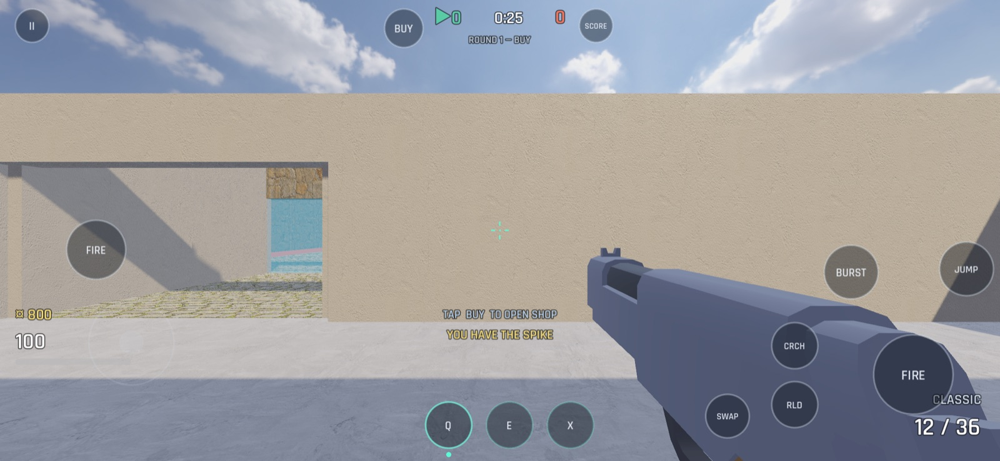
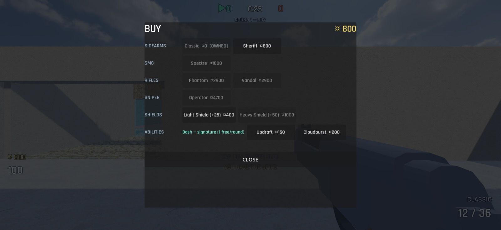
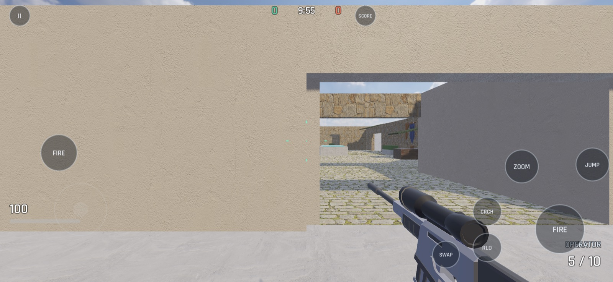
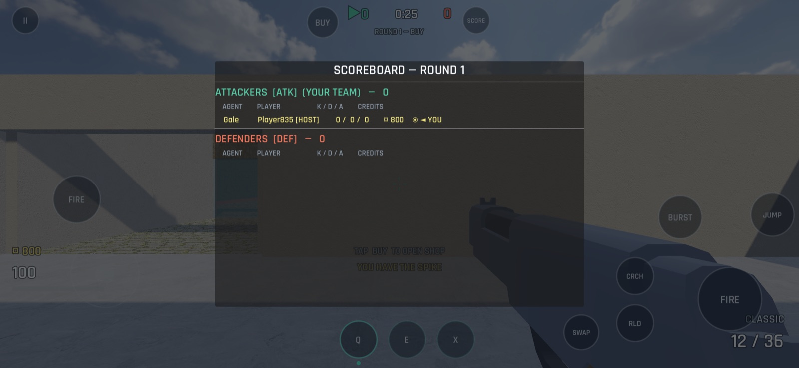

# Valu

Valu is an original, free and open-source tactical FPS built for Android and
desktop with Godot 4.7.1. Up to ten players can play over local Wi-Fi: one
device hosts the match, and the others discover it automatically or join by IP.
No account or dedicated server is required.

[Download the latest Android APK from GitHub Releases](https://github.com/daksh-mor/valu/releases/latest)

The Android build targets 64-bit ARM devices running Android 7.0 (API 24) or
newer.

## Features

- Spike mode with buy phases, planting, checkpointed defusing, side swaps,
  shields, and a full round economy
- Team deathmatch for quick games and warmups
- Seven weapons with recoil, movement error, range falloff, alternate fire,
  and scoped zoom
- Four playable agents with twelve server-validated abilities
- Solstice, a competitive two-site map, plus a graybox test map
- Mobile-first touch controls with a floating joystick, drag aim, dual fire
  buttons, and configurable sensitivity and render scale
- Server-authoritative combat over ENet, with LAN discovery and manual-IP
  fallback

## Screenshots

<p align="center">
  
  
</p>
<p align="center">
  
  
</p>

## Install and play over LAN

1. Download the APK from the
   [latest GitHub release](https://github.com/daksh-mor/valu/releases/latest)
   and sideload it on each phone.
2. Put every device on the same Wi-Fi network or personal hotspot.
3. On one device, choose **Host Game**, then select the mode, map, and team
   size.
4. On the other devices, choose **Join Game** and select the discovered host.
   If discovery is blocked by the network, enter the host's displayed IP
   address manually.

Valu uses UDP port 27015 for matches and 27016 for discovery. See the
[phone setup and troubleshooting guide](docs/PLAY_ON_LAN.md) for detailed
instructions.

## Run on desktop

Install the
[standard Godot 4.7.1 editor](https://godotengine.org/download/archive/4.7.1-stable/),
then launch the project:

```bash
GODOT="/Applications/Godot.app/Contents/MacOS/Godot"
"$GODOT" --version  # must report 4.7.1.stable
"$GODOT" --path "$PWD"
```

For a two-instance local match:

```bash
GODOT="/Applications/Godot.app/Contents/MacOS/Godot"
"$GODOT" --path "$PWD" -- --host --map solstice --mode spike --start-when 2
"$GODOT" --path "$PWD" -- --join 127.0.0.1
```

Use `-- --touch` to show the mobile controls on desktop. Desktop bindings are
WASD + mouse, Shift to walk, Ctrl/C to crouch, right click for alternate
fire/aim, R to reload, F to plant/defuse, Q/E/X for abilities, B for the buy
menu, and Tab for the scoreboard.

## Build from source

Requirements:

- Godot **4.7.1 stable** and the matching **4.7.1 export templates**
- JDK **17**
- Android SDK with build-tools **35.0.0**

In Godot's Editor Settings, set the Android SDK path and Java SDK path. On an
Apple Silicon Mac using Homebrew, the exact import and debug-export commands
are:

```bash
brew install openjdk@17
export JAVA_HOME="/opt/homebrew/opt/openjdk@17"
export PATH="$JAVA_HOME/bin:$PATH"
GODOT="/Applications/Godot.app/Contents/MacOS/Godot"

mkdir -p builds
"$GODOT" --headless --path "$PWD" --import
"$GODOT" --headless --path "$PWD" --export-debug "Android" builds/Valu-debug.apk
```

A signed release export uses the same imported project and this exact command:

```bash
GODOT="/Applications/Godot.app/Contents/MacOS/Godot"
"$GODOT" --headless --path "$PWD" --export-release "Android" builds/Valu-1.0.0.apk
"$HOME/Library/Android/sdk/build-tools/35.0.0/apksigner" verify \
  --verbose --print-certs builds/Valu-1.0.0.apk
```

Release export requires your own signing key through Godot's
`GODOT_ANDROID_KEYSTORE_RELEASE_PATH`,
`GODOT_ANDROID_KEYSTORE_RELEASE_USER`, and
`GODOT_ANDROID_KEYSTORE_RELEASE_PASSWORD` environment variables. Never commit
a keystore, passwords, or signing configuration.

## Tests

```bash
bash tests/two_instance_test.sh
bash tests/spike_test.sh
bash tests/three_instance_solstice_test.sh
```

The suites cover host/client connection and combat replication, Spike rounds
and abilities, and a three-player plant/defuse/detonation flow on Solstice.

## Package and version

- Android package: `io.github.daksh_mor.valu`
- Version: `1.0.0` (`versionCode` 1)
- Android architecture: `arm64-v8a`
- Minimum Android version: API 24
- Export preset: `Android`

## Current limitations and roadmap

- Multiplayer is LAN-only; there is no internet matchmaking, relay, or account
  service.
- Version 1 ships one finished competitive map and no bots, progression,
  ranked queue, or voice chat.
- Late joiners do not receive already-active short-lived walls or smokes.
- Spike blast damage does not perform a line-of-sight check.
- Solstice uses real-time lighting until its configured lightmaps are baked in
  the editor.
- Future candidates include more maps, ultimate abilities, gyro aiming,
  improved spectating, a touch-layout editor, and additional platforms.

## Documentation

- [Play on LAN](docs/PLAY_ON_LAN.md)
- [Toolchain and project conventions](docs/CONVENTIONS.md)
- [Complete asset manifest](docs/ASSETS.md)
- [Credits and third-party notices](CREDITS.md)

## License

Valu's project-authored source code, media (including artwork, icons,
branding, UI assets, and audio), documentation, and repository/store metadata
are licensed under the [MIT License](LICENSE), copyright (c) 2026 Daksh Mor.

The MIT license does not relicense bundled third-party engine code, art,
audio, or fonts. Those files retain their original MIT, CC0, CC BY 3.0, or
SIL OFL 1.1 terms.
Required attribution, source URLs, and bundled license locations are recorded
in [CREDITS.md](CREDITS.md) and [docs/ASSETS.md](docs/ASSETS.md).
